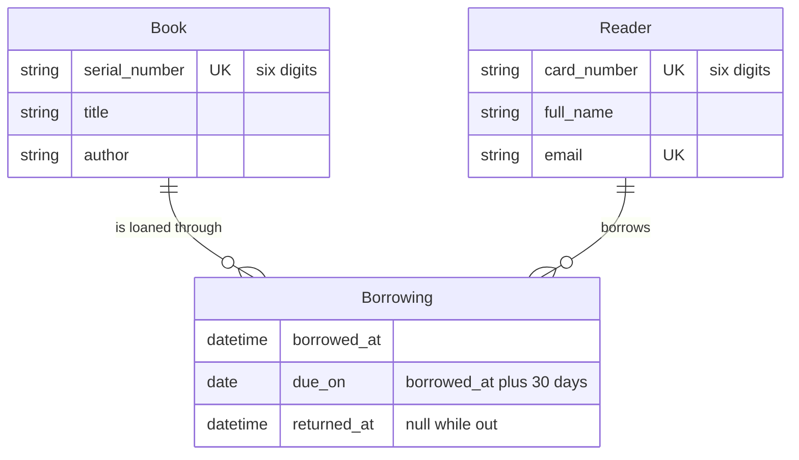
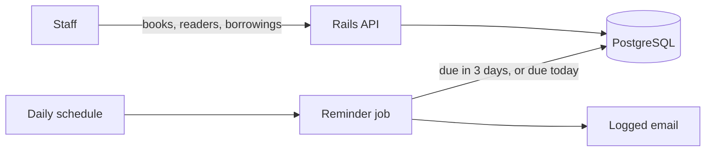

# Library management API

Staff track books the library owns: identity, whether a copy is out, and who has borrowed it. Readers are people who hold a library card. A loan lasts 30 days. The library reminds the reader 3 days before the due date and again on the due date. Authentication is out of scope. Email is logged, not sent.

## Functional requirements

1. Add a book.
2. Delete a book.
3. List every book as available or borrowed.
4. Show one book with its full borrowing history: borrow date, return date, reader.
5. Register, list, show, update, and remove a reader.
6. Create a borrowing, which marks the book borrowed.
7. Update a borrowing, which marks the book returned.
8. Remind the reader 3 days before the due date and on the due date.

## Constraints

- Ruby on Rails API, PostgreSQL.
- `docker compose up` boots a working application.
- No authentication.
- Reminder delivery is a log line or a mailer preview.

## Non-functional requirements

These bounds are assumptions for a single library. The brief does not state them. They are what the API is sized for.

- Up to 100,000 books.
- Up to 50,000 readers.
- At most one open borrowing per book, so current loans stay within the book count.
- Borrowing history is kept for the life of the copy. A copy goes out a few times a year, so a decade of history is a few million rows, not a daily stream.
- A handful of staff use the API at once. One PostgreSQL instance is enough. Nothing is cached in front of reads.

`GET /books` and `GET /readers` are paginated with [Pagy](https://ddnexus.github.io/pagy/). A default page is 50 records, and a page cannot ask for more than 100. One response with the whole catalog would be a large JSON payload for a staff client, and it would grow every time the library bought books.

`GET /books/:serial_number` returns that copy's full history in one response. One copy accumulates dozens to a few hundred loans, which fits a single payload. There is no `GET /borrowings` collection. History is read through the book.

The reminder job runs once a day. It selects open borrowings whose due date is today or three days out. An index on that query is enough at this size. The job does not need batching or a separate worker fleet.

## Core entities



A book is borrowed while it has a borrowing with `returned_at` null. Creating a borrowing marks the book borrowed. Updating it sets `returned_at` and marks the book available. Status and history live in one table.

Readers are their own resource. A borrowing points at a reader that already exists. Deleting a book or a reader is refused while a borrowing for it is still open.

## API

```text
POST   /books
GET    /books
GET    /books/:serial_number
DELETE /books/:serial_number

POST   /readers
GET    /readers
GET    /readers/:card_number
PATCH  /readers/:card_number
DELETE /readers/:card_number

POST   /borrowings
PATCH  /borrowings/:id
```

`POST /borrowings` takes a book serial number and a reader card number. The API sets `borrowed_at` to now and `due_on` to 30 days later. It refuses the loan when the book is already out or the reader does not exist.

`PATCH /borrowings/:id` sets `returned_at`. That is the return. There is no status field on the book.

`GET /books` and `GET /readers` report one page at a time, with `page`, `per_page`, `total_count`, and `total_pages`. Each book in the list is available or borrowed. `GET /books/:serial_number` includes every borrowing, with borrow date, return date, and the reader.

Reminders are not an endpoint. A daily job reads open borrowings and logs the email.

## High-level design



## Running

The production stack is the one a reviewer starts:

```bash
docker compose up --build
```

The API listens on `http://localhost:3000`. The image runs `RAILS_ENV=production`. Solid Queue shares the Puma process, which is where the reminder job will run.

For development, with the app directory mounted and Postgres published on port 5432:

```bash
docker compose -f docker-compose.dev.yml up --build
```

That stack also binds port 3000, so run one compose file at a time. If port 5432 is already taken, change the dev mapping to `"5433:5432"`. The app still reaches Postgres at `db:5432` inside the compose network.

Future Improvements:

1. Scalability & Pagination:
- Currently, the endpoint GET /api/v1/books uses traditional offset-based pagination (via pagy gem), which is perfectly sufficient for a standard library catalog where office staff needs page numbers and random access to data. However, if the library system scales to millions of book items, this approach could hit performance bottlenecks on deep pages due to OFFSET scanning behavior in PostgreSQL.Future transition: If we were to implement a mobile app for readers with an infinite scroll interface, I would consider switching that specific endpoint to Keyset / Cursor Pagination